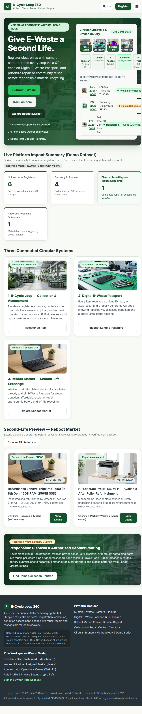

# E-Cycle Loop 360 — Smart E-Waste Collection, Tracking, Reuse & Recycling Platform

## Project Structure
- `index.html` — Modular main entry point (links to `css/styles.css`, `js/app.js`, and `assets/images/`).
- `css/styles.css` — Stylesheet including custom eco-tech theme variables, glassmorphic cards, keyframe animations, and responsive layout rules.
- `js/app.js` — Application logic, IndexedDB photo storage service (`PhotoStorageService`), local storage repository (`DataRepository`), role-based authentication (`AuthService`), deterministic offline SVG QR code generator, live camera capture modal, and SPA router.
- `assets/images/` — High-resolution photographic assets (`hero_studio.jpg`, `collection_hub.jpg`, `laptop_refurbished.jpg`, `smartphone_repair.jpg`, `monitor_display.jpg`, `laser_printer.jpg`).
- `screenshots/` — Captured application screenshots for the project overview.
- `e_cycle_loop_360_standalone.html` — Self-contained single-file build with all CSS, JS, and base64 images inlined for zero-dependency 1-click browser launch.

## Screenshots

### Home page

## How to Run
1. **Modular Version**: Open `index.html` in any modern web browser (or serve the folder with VS Code Live Server / `python3 -m http.server 8000`).
2. **Standalone Version**: Double-click `e_cycle_loop_360_standalone.html` to run directly in any browser without a local server.

## Background Role Accounts (For Testing & Presentation)
Login credentials are kept hidden from the public UI for a clean, production-like experience, while remaining active in the authentication service:

| Role | Email | Password | Default Workspace |
| :--- | :--- | :--- | :--- |
| **Administrator** | `admin@ecycleloop.demo` | `Admin@123` | `/admin` |
| **Resident / User** | `user@ecycleloop.demo` | `User@123` | `/dashboard` |
| **Resident / User (Student)** | `rahul@ecycleloop.demo` | `User@123` | `/dashboard` |
| **Collection Worker** | `worker@ecycleloop.demo` | `Worker@123` | `/tasks` |
| **Repair & Reuse Partner** | `repair@ecycleloop.demo` | `Repair@123` | `/tasks` |
| **Recycling Partner** | `recycler@ecycleloop.demo` | `Recycler@123` | `/tasks` |
